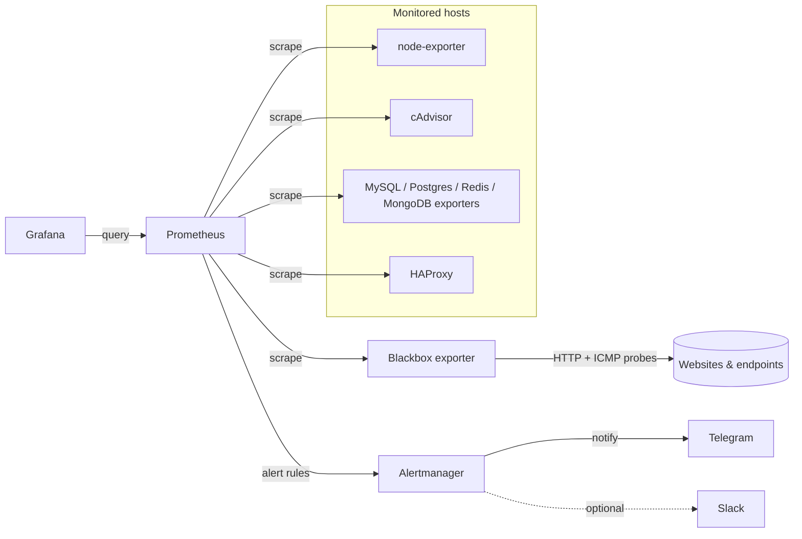

# infra-docker-config

Docker Compose setups I wrote and ran for self-hosted infrastructure: monitoring and alerting, databases, an API gateway, logging and developer tools. Each folder is independent and starts on its own.

## What's inside

| Area | Folder | Notes |
|---|---|---|
| Monitoring and alerting | [`prometheus/monitoring_server`](prometheus/monitoring_server) | Prometheus, Alertmanager, Grafana, Blackbox exporter, cAdvisor |
| Exporters | [`prometheus/cadvisor`](prometheus/cadvisor), [`prometheus/mysql_exporter`](prometheus/mysql_exporter), [`prometheus/postgres_exporter`](prometheus/postgres_exporter) | Deployed next to the services they watch |
| API gateway | [`kong`](kong) | Kong 3.6 on PostgreSQL, with a one-shot migration container |
| Caching | [`redis`](redis) | Primary/replica pair with AOF persistence, password auth and `allkeys-lru` eviction |
| Databases | [`mysql`](mysql), [`mongodb`](mongodb), [`mssql`](mssql) | Admin UIs in [`phpmyadmin`](phpmyadmin) and [`pgadmin`](pgadmin) |
| Database monitoring | [`pmm`](pmm) | Percona Monitoring and Management |
| Logging | [`graylog`](graylog) | Graylog with MongoDB and Elasticsearch |
| Object storage | [`minio`](minio) | S3-compatible storage |
| Dev tools | [`sonarqube`](sonarqube), [`nexus`](nexus), [`jira`](jira), [`confluence`](confluence), [`portainer`](portainer) | Code quality, artifact registry, issue tracking, docs, container UI. [`mattermost`](mattermost) links to the official setup. |

## Monitoring stack



Prometheus scrapes node-exporter, HAProxy, Redis, MongoDB, cAdvisor and itself. The Blackbox exporter adds HTTP and ICMP probes, which measure uptime and latency from outside the hosts.

The [alert rules](prometheus/monitoring_server/prometheus/alert_rules) fire on a host or service going down, high CPU, memory or disk usage, slow ping times and unexpected HTTP status codes. Alertmanager sends them to Telegram with a [custom message template](prometheus/monitoring_server/alertmanager/telegram_custom_template.tmpl), and a Slack receiver is included as well.

Grafana starts with Prometheus already provisioned as a data source, and user sign-up is turned off.

## Usage

Each folder runs on its own:

```bash
cd kong
docker compose up -d
```

Set your own credentials before you use any of these for real. The passwords in the compose and `.env` files are placeholders (`change-me`) or local development defaults. Put real values in each folder's `.env`, which Compose loads automatically, and keep that file out of git.

The Redis replica reads its connection settings from its own env file:

```bash
cd redis
docker compose -f docker-compose.master.yml --env-file .env.master up -d
docker compose -f docker-compose.slave.yml  --env-file .env.slave  up -d
```

For the monitoring stack, add your Telegram bot token and chat ID to `alertmanager/config.yml` and your own targets to `prometheus/prometheus.yml`.

## Design notes

Every service has its own folder, so I can deploy, upgrade or remove one stack without touching the others.

Prometheus rules, Alertmanager routing, Blackbox modules and Grafana data sources are all files in this repo, so a monitoring server can be rebuilt from it.

Exporters report what happens inside a service, and the Blackbox probes check what a user would see from outside.

Databases use named volumes and Redis writes an append-only file, so data survives container restarts.
